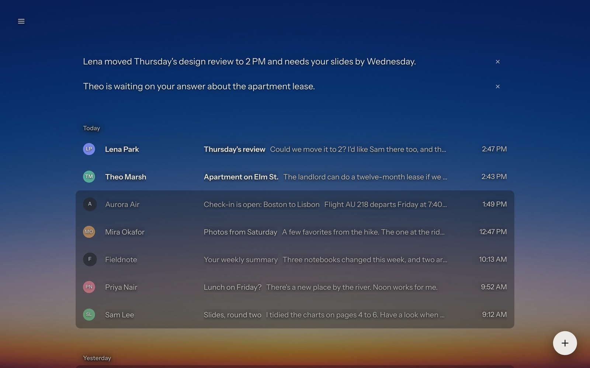

# Umbra Mail

**A calmer Gmail.** Private, free and open source. · [umbra.masn.studio](https://umbra.masn.studio) · [Install](https://umbra.masn.studio/#install) · [Privacy](https://umbra.masn.studio/privacy)



Umbra Mail is a calmer Gmail. It redraws Gmail's inbox, conversations and search in a quiet, readable design, and it changes when new mail reaches you: a few times a day, all at once, instead of one email at a time all day. Gmail stays underneath. Every action you take (Done, Delete, Send) is handed back to Gmail, and nothing about your mail changes because Umbra shows it differently.

Umbra collects zero data. There's no Umbra server and no analytics. AI is off until you choose it.

## Install

- **Userscript, any browser:** install it from [umbra.masn.studio](https://umbra.masn.studio/#install) with [Violentmonkey](https://violentmonkey.github.io/get-it/) or [Tampermonkey](https://www.tampermonkey.net/). It updates from there.
- **Chrome extension:** coming to the Chrome Web Store. Until then, download [the .zip](https://umbra.masn.studio/umbra-extension.zip), unzip it, turn on Developer mode in `chrome://extensions`, and choose Load unpacked. It needs Chrome 116 or later.
- **From source:** `npm run build`, then install `dist/umbra.user.js`, or load `dist/extension/` unpacked.

The first time Gmail opens with Umbra, a short welcome plays: an eclipse, what Umbra is, how new mail should arrive, and whether to use AI (with the provider's terms to agree to). ⌘K › Welcome to Umbra shows it again.

## What it does

### Reading

- **The brief.** With AI on, a few lines at the top of the inbox say what needs you, and from whom. They come from Gmail's own Gemini to-dos where your account has them, and from Umbra's AI otherwise.
- **Conversations you can read.** Whole conversations open as one page, and earlier replies quoted under each message fold away.
- **Reader view.** A designed email as plain text and its pictures. Reading type can be Sans, Serif, Editorial or Mono.
- **Catch me up.** A long conversation with new messages since your last visit says how many and takes you to the first one. With AI, it can also tell you what they say.
- **People cards.** Click a sender's name to see the conversations you've had with them, their files, and how their mail reaches you.
- **Link reveal.** Point at a link to see where it really goes, past click-counting redirects. It warns you when the words name one site and the link goes to another.
- **Tracker notes.** An email with tracking pixels says "Tracks opens", and Umbra's copy of it leaves the pixels out.
- **Codes.** Sign-in and verification codes show on their email's row, ready to copy.
- **Dual view.** The list stays on the left while you read on the right.

### Calm

- **Tides.** New mail arrives twice a day, three times, or at times you pick, all at once. People you've marked, people waiting on you, and conversations you're part of can come through anyway. You can always let the tide in early.
- **The paper.** Newsletters and notifications fold into one page, in sections, with a new edition each morning. Mail from people never goes there.
- **Sender rules.** From any email's "…" menu, let a sender through always, send them to the paper, or quiet them for a month.
- **Not opened.** Subscriptions you haven't opened anything from in 60 days, with one button to unsubscribe from all of them through Gmail's own Unsubscribe.
- **Your time.** Minutes a week each sender has had of your attention, counted only while their mail is open in front of you, and kept only on your computer.
- **An inbox that ends.** It can stop after two weeks or a month, and it says when you're caught up.
- **Fewer numbers.** The tab can say "Inbox" instead of "Inbox (3,145)", and automated mail can sit a step dimmer than people.

### Writing

- **Templates on ⌘;.** Replies you write again and again, with `{first}`, `{name}`, `{company}`, `{today}`, `{tomorrow}`, `{subject}` and more filled in.
- **Considerate sending.** Late at night, Umbra offers to send at 8:00 the next morning with Gmail's Schedule send. It points out words that read heated, and notices a reply that mentions an attachment but has none. Each is asked only when it applies.
- **Promises.** "I'll send the slides by Friday" in mail you sent becomes a quiet line at the top of the inbox until you mark it done. This is found on your computer, without AI.
- **Drop files anywhere.** Over a conversation they attach to your reply. Anywhere else they start a new message.
- **Change accounts mid-message.** Pick another From account and the message moves to that account's Gmail with your words in it.

### Finding and doing

- **⌘K.** Filter the list, switch accounts, start a message from any account, open a draft, act on what's selected, or ask a question.
- **Local recall in ⌘K.** Mail Umbra has seen is remembered on your computer (subject, sender, first line), so ⌘K finds it as you type.
- **Pinned searches.** Pin a search and it sits in the menu and in ⌘K.
- **Selection and bulk actions.** ⌘-click, ⇧-click for a run, `x`, or ⇧J and ⇧K. Then Done, Delete, Star, or mark read or unread, all at once.
- **g, then a letter.** `g i` for the inbox, `g s` for starred, `g f` for files, and more. ⌘1 to ⌘9 open the menu's first nine places.
- **Undo.** ⌘Z undoes the last thing you did.
- **Everything.** One list across all your signed-in Gmail accounts, merged by date.

### Files

- **Files.** Every attachment in your mail, and the big files Gmail sent as Drive links, newest first. Narrow them by kind, by sender, or to large files only. They open in place with previews, download, or lead to their email.
- **Keep copies, delete emails.** To make room in your Google storage, Umbra saves each file to your Downloads folder first, and only then moves the email to Trash. An email whose files couldn't all be saved stays where it is.

### Looks

- **Dark, Bright, or Match system.**
- **Backgrounds.** A color, your own picture, or the sky as it is now: dawn, day, golden hour, dusk, and stars at night. A picture can follow the time of day too.
- **Glass and grain**, each a slider. Soft depth, text size, spacing, reading width, and an accent that can follow the account you're in.
- **Flags.** Settings › Flags lists every setting by name, like `about:config`, and takes your own CSS.
- **Export and import.** Your settings as a file, to move to another computer. Save this look shares only the look.

### AI

All optional, and off until you turn it on.

- Summaries of long conversations, suggested replies, and Write with AI (⌘J) in your own voice.
- Answers to questions about your mail, with their sources, from Find (`/`) or ⌘K.
- Gemini's notes on new mail, from a Google Workspace Studio flow in your own account: piles by kind, due dates, and the one detail worth seeing.

## Keyboard

⌘ means Ctrl on Windows and Linux. Most of these keys can be changed in Settings › Shortcuts, and `?` shows them all.

| Where | Key | Does |
| --- | --- | --- |
| Anywhere | ⌘K | Filter, switch account, write, ask |
| | `/` | Find |
| | `c` | New message |
| | `\` | Menu |
| | `?` | Shortcuts |
| | ⌘, | Settings |
| | ⌘Z | Undo |
| Lists | `j` / `k` | Next / previous conversation |
| | `o` or ↵ | Open |
| | `e` | Done (archive) |
| | `h` | Later (snooze) |
| | `s` | Star |
| | ⇧U / ⇧I | Mark unread / read |
| | `#` | Delete |
| | `x` | Select |
| | ⇧J / ⇧K | Select, and move down / up |
| | esc | Clear the selection or filters |
| Conversations | `r` / `a` / `f` | Reply / Reply all / Forward |
| | `u` or esc | Back |
| | `e` | Done |
| | `j` / `k` | Next / previous conversation |
| | ⌘↵ | Send |
| | ⌘; | Templates, in any message |
| | ⌘J | Write with AI |
| Go to | `g i`, `g s`, `g l`, `g d`, `g t`, `g a`, `g e` | Inbox, Starred, Later, Drafts, Sent, All mail, Done |
| | `g p`, `g f`, `g n`, `g o` | The paper, Files, Senders, To-dos |
| | ⌘1 to ⌘9 | The menu's first nine places |

`g p` works when the paper is on, and `g o` where Gmail has to-dos. Chrome keeps ⌘1 to ⌘9 for its own tabs; Firefox and Zen let them through.

## AI

AI is off until you choose it, in the welcome or in Settings › AI. With it off, Umbra does everything else and nothing is sent to any AI.

Where your Google account has Gemini in Gmail, Umbra uses Gmail's own to-dos and suggestions first. For everything else, pick one provider:

- **Gemini, OpenAI or Anthropic, with your own API key.** Requests go straight from your browser to that provider. Your key is kept in the browser on your computer and is sent only to its own provider.
- **Chrome's built-in model** ("On this device"), where your Chrome and computer can run it. No key, and nothing leaves your computer. It can't answer questions about your mail; those need a key.
- **Sign in with ChatGPT.** Your Plus or Pro plan, no key, all in the browser. OpenAI sends the sign-in back to `127.0.0.1:47824`, where nothing listens: the extension catches that address itself; as a userscript, you paste it into Umbra.

What goes to the provider, and when:

- **The brief:** sender, subject, first line and time of up to 25 recent conversations, when the brief is on and Gmail's Gemini isn't writing it.
- **Summaries:** the conversation's text, with quoted replies left out. Made as a long conversation opens (the default), only when you ask, or never.
- **Catch me up:** the new messages, when you press Catch me up.
- **Suggested replies:** the conversation, your name, and the notes about you. By default only when someone is waiting on you.
- **Write with AI (⌘J):** your instruction, your draft, the conversation and its recipients.
- **Find and questions:** your question, and for questions also your name, your accounts and the notes about you. Then the search results and conversations the AI asks to read, from any of your signed-in accounts.
- **What Umbra knows about you:** about once a week, your name, your accounts, the people you write to most, and the subjects and first lines of recent mail you sent. The result is a few lines you can read and edit in Settings › AI.

Settings › AI shows how many requests and tokens were used today.

The optional Gemini notes come from a Workspace Studio flow that runs in your own Google account and writes to a sheet in your Drive. Umbra reads that sheet with your Google sign-in. Connect it in Settings › Gemini.

## Privacy

Umbra Mail has no server of its own. It sends nothing to its developer: no analytics, no telemetry, no ads. Settings and caches stay in your browser on your computer. Your mail goes to an AI provider only if you turn AI on and pick one, and only what a request needs. The full policy is in [PRIVACY.md](PRIVACY.md).

## Build from source

There is nothing to install from npm.

```sh
npm run build   # node build.mjs, then ESLint 8 on the userscript (npx fetches it the first time)
npm test        # node --test tests/
```

`node build.mjs` on its own builds without the lint. The build writes:

- `dist/umbra.user.js`, the userscript
- `dist/extension/`, the Chrome extension, ready to load unpacked or zip for the store
- `dist/site/`, the website (deployed with `vercel deploy --prod` from there)
- `dist/umbra.dev.js` and `dist/dev.css`, for the development harness only

How the source is laid out:

| Path | What it is |
| --- | --- |
| `src/lib/` | Pure helpers with no page access: time, tides and the sky (`calm.js`); codes, due dates, promises, tone, links, trackers and templates (`text.js`). The tests load them on their own. |
| `src/umbra.js` | The core. It reads Gmail's page, draws Umbra's own screens, and hands every action back to Gmail. Accounts, the brief, Files, ⌘K, the keyboard and settings live here. |
| `src/parts/` | Features, joined in file-name order: `05-eclipse` (the welcome's eclipse, in WebGL), `10-calm`, `15-motion`, `20-power`, `30-writing`, `40-direct-ai` (all AI, including Sign in with ChatGPT), `50-reading`, `60-looks`, `70-settings`, `75-intro` (the welcome). `zz-start.js` starts everything. Each file opens with a comment on what it does. `*.dev.js` files go only into the dev build. |
| `src/umbra.css` | All styles. |
| `extension/` | The manifest, `compat.js` (the userscript's `GM_*` calls answered with extension APIs), `background.js` (requests to the sites the manifest names, new tabs, ChatGPT's sign-in coming back, the toolbar button), `signin.html`, the options page, bundled fonts, and the icons (drawn by `docs/store/render.mjs`, with the store's pictures). |
| `site/` | [umbra.masn.studio](https://umbra.masn.studio): the page, its demo (Umbra's own stylesheet, with an inbox that's made up), and Vercel's config. The build adds the eclipse, the userscript, the extension .zip and the privacy page to `dist/site/`. |
| `tests/` | `node:test` suites for the helpers, AI in the browser, and the extension build. |

Umbra builds every node by hand and never uses `innerHTML`, because Gmail enforces Trusted Types.

## License

[GNU General Public License v3.0](LICENSE). The bundled fonts, Instrument Sans and Newsreader, are under the SIL Open Font License 1.1; their license files are in `extension/fonts/`.
